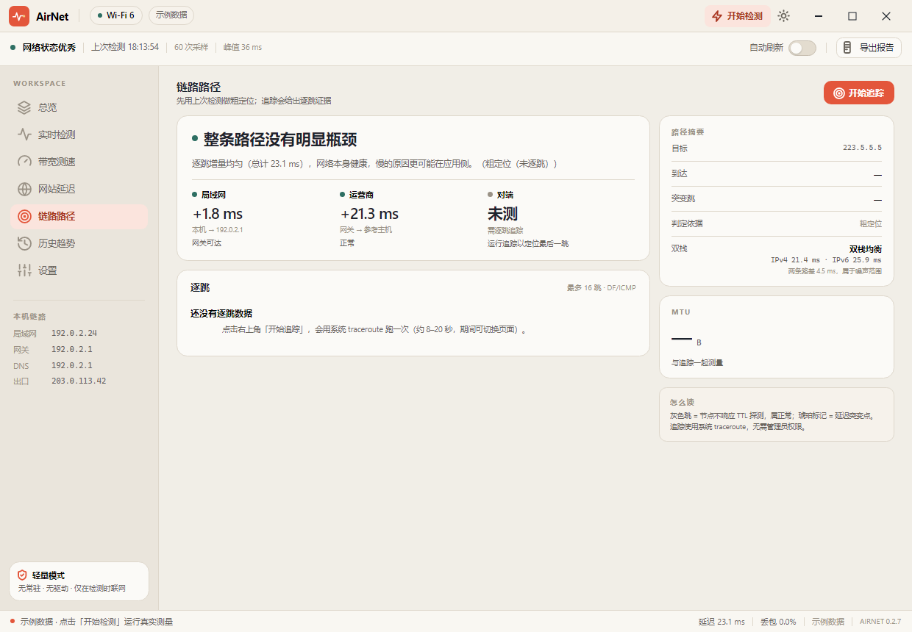

# AirNet

**轻量、快速的网络检测与优化工具** —— 点一下，一次告诉你网络好不好、带宽够不够、问题在路由器还是运营商。

基于 .NET 10 + Avalonia 11.3 的轻量网络诊断工具；Windows/macOS/Linux 正式包均使用 Native AOT。

[](https://github.com/RyzenWang/AirNet/actions/workflows/ci.yml)
[](https://github.com/RyzenWang/AirNet/releases/latest)
[](LICENSE)




---

## 当前状态

**M3 主要能力已落地**：七页界面、评分与诊断、真实探测（含亚毫秒抖动）、三段归因、逐跳路径、
MTU、网站延迟（含自定义站点）、上下行测速、IPv4/IPv6 双栈、代理/VPN 识别、DNS 三方对比、
`--probe --json`、历史差值、历史趋势页、分享卡片、Wi-Fi 邻区扫描、游戏/会议模式、报告导出、
一键 DNS（含还原）、设置持久化、快捷键、五平台 Native AOT 发布矩阵、CI 都已跑通。

| 部分 | 状态 |
| --- | --- |
| 平台支持 | Windows x64 / Linux x64 ✅ Native AOT 运行验证；Linux arm64、macOS x64/arm64 ✅ CI AOT 构建通过，🟡 运行待真机验证 |
| 视觉系统（七页 × 深浅色） | ✅ M0/M2 |
| 真实探测：ICMP 丢包 / TCP 计时 / DNS·TCP·TLS·TTFB | ✅ M1 |
| 亚毫秒抖动（`Stopwatch` 计时 TCP 握手） | ✅ 本机实测 2.6ms（原先恒为 0） |
| Wi-Fi 信号 / 速率 / PHY（wlanapi） | ✅ 2026-11-12 在真实无线网卡上验证可用（SSID / 信号 / 速率 / PHY 代际） |
| 评分、场景估计、规则诊断 | ✅ M1 |
| 历史（JSONL，30 天，裁剪安全） | ✅ M1 |
| 带宽测速（单流，上下行） | ✅ 手动检测内置下/上行测速；也可在测速页单独重测；失败显"未测出"，不写假值 |
| **网站延迟**（11 默认 + 自定义） | ✅ 首字节四段分解、3 次中位数、HTTP 状态识别；自定义站点落 `sites.json`，历史落 `sites.jsonl` |
| **出口 IP**（Cloudflare / 3322，best-effort） | ✅ 被拦截时显示"未获取"，不阻塞扫描 |
| **三段归因**（局域网 / 运营商 / 对端） | ✅ M2 粗定位 + 逐跳定位 |
| **逐跳路径**（系统 traceroute，本地化无关解析） | ✅ M2 实测 14 跳 / 17s；目标未响应时不误判对端 |
| **MTU**（DF 二分） | ✅ M2 实测 1480（PPPoE） |
| **报告导出**（自包含 HTML，可打印 PDF） | ✅ M2 7.8KB / 零脚本 / 地址掩码 |
| **一键 DNS + 还原**（Windows 提权） | ✅ M2 命令先展示，还原记录落盘 |
| **单元测试**（xUnit） | ✅ 142 项：统计 / 分档 / 解析 / 掩码 / 历史 / DNS / 双栈 / 代理 / 邻区 / 模式 / 站点目录与 HTTP 状态 |
| **设置**（持久化 / 自动刷新 / 键盘快捷键） | ✅ M2，写入 `settings.json`；60s 自动刷新仅在窗口可见时执行 |
| Windows 正式发布 | ✅ Native AOT：16.83MB zip（CI）；本机启动 411ms / 内存 118.9MB；需保留同目录原生 DLL |
| macOS / Linux 发布 | ✅ CI AOT 构建通过：Linux x64/arm64 约 16MB，macOS 约 27–29MB；Linux x64 实机运行通过，arm64/macOS 待验证 |
| CI（构建 + 单元测试 + 探针冒烟 + 报告断言 + 截图工件） | ✅ M2 |
| **动效**（扫描/测速/追踪扫描带、实时读数、环/条填充、数字滚动、曲线扫入、页面淡入） | ✅ M2，截图模式可关闭 |
| **IPv4/IPv6 双栈** | ✅ 同一主机两条路各 5 次握手，给出「均衡 / IPv6 更快 / IPv6 偏慢」，偏慢时进诊断 |
| **代理 / VPN 识别** | ✅ 检测系统代理与隧道网卡，明确标注「经代理 / 经 VPN」并说明哪些数字因此失真 |
| **DNS 三方对比** | ✅ 同一域名实测「当前 / 223.5.5.5 / 1.1.1.1」，差 20% 且 ≥5ms 才建议更换 |
| **CLI JSON** | ✅ `--probe --json out.json`，稳定 schema + 退出码（0 健康 / 1 一般 / 2 较差 / 3 失败） |
| **历史差值** | ✅ 每条历史显示与上次的分数 / 延迟 / 抖动 / 下行变化，一眼看出改动是否有效 |
| **历史趋势页** | ✅ 7 / 30 天延迟与评分曲线、凌晨/上午/下午/晚间时段观察、最近记录 |
| **分享卡片** | ✅ 一键生成 1080 × 1350 PNG，复用当前体检结论和纸面视觉 |
| **Wi-Fi 邻区** | ✅ Windows WLAN API 只读扫描 SSID/BSSID/信号/PHY/速率；有线连接明确跳过，不伪造信道 |
| **游戏模式** | ✅ UDP/STUN RTT、抖动、丢包 + NAT 映射行为启发式；不是实际游戏服务器 RTT |
| **会议模式** | ✅ 2MB 上行 + TCP 抖动/丢包，给出 1080p / 720p / 风险结论 |
| 邻区信道分析、游戏/会议以外的场景 | ⬜ 见 [技术方案](docs/TECH_PLAN.md) |

正常启动不预填样例/固定值：界面显示等待检测，点"开始检测"后才写入本次测量。
`--export` 截图模式仍使用确定性样例数据，仅用于视觉评审，不会进入真实历史。

Release 下载：<https://github.com/RyzenWang/AirNet/releases/latest>。  
参与开发前请读 [CONTRIBUTING.md](CONTRIBUTING.md)；安全问题见 [SECURITY.md](SECURITY.md)；
第三方许可见 [THIRD_PARTY_NOTICES.md](THIRD_PARTY_NOTICES.md)。

## 快速开始

需要 .NET 10 SDK。

```powershell
git clone <repo> ; cd AirNet

dotnet run --project src/AirNet.App                              # 启动应用
dotnet run --project src/AirNet.App -- --selftest out.txt        # 跑一轮真实探测 + 历史往返，输出报告
dotnet run --project src/AirNet.App -- --sites sites.txt          # 真实跑 11+ 个站点，输出四段/HTTP 状态
dotnet run --project src/AirNet.App -- --probe --json probe.json  # 脚本用：JSON + 退出码
dotnet run --project src/AirNet.App -- --report report.html      # 真测一轮并导出 HTML 报告（含最近站点表）
dotnet run --project src/AirNet.App -- --export docs/shots --scale 1   # 重新生成全部截图（动效自动关闭）
dotnet run --project src/AirNet.App -- --scan-shot scan.png      # 抓一张"检测中"的界面（动效开启）
dotnet test tests/AirNet.Core.Tests/AirNet.Core.Tests.csproj     # 纯逻辑单元测试

powershell -File packaging/publish.ps1                           # 裁剪单文件发布 + 实测启动/内存
powershell -File packaging/pack-aot.ps1                           # Windows Native AOT 正式包
powershell -File packaging/pack-portable.ps1                     # Windows R2R 回退/对照包
powershell -File packaging/pack-all.ps1                          # Windows AOT + macOS/Linux R2R 全部资产
```

本地验证和 Release 只出**免安装便携包**，不含 setup/安装器：

| 平台 | 文件 |
| --- | --- |
| Windows x64 | `AirNet-<version>-win-x64-aot.zip`，解压双击 `AirNet.exe`；需保留同目录原生 DLL |
| macOS Apple Silicon / Intel | `AirNet-<version>-macos-arm64-aot.zip` / `-macos-x64-aot.zip`，解压得到 `AirNet.app` |
| Linux x64 / arm64 | `AirNet-<version>-linux-x64-aot.tar.gz` / `-linux-arm64-aot.tar.gz`；解压后直接 `bash run.sh`（只提供一个归档，要求 glibc ≥ 2.35） |

> 当前最新 Release 仍是 `v0.2.6`；`v0.2.7` 起 Windows/macOS/Linux 全部改走 AOT。


Linux 包要求 glibc ≥ 2.35，需要 X11 或 Wayland（XWayland）及常见桌面库；Linux x64 AOT 已在真实环境验证，arm64 待验证。macOS 包未签名/未公证，暂未在真机验证。CI 会把 Windows/macOS 的 zip 与 Linux 的 tar.gz 挂到对应 Release，不构建 setup。

`--selftest` 的输出示例（本机，有线 1000M）：

```
interface=以太网      local=192.0.2.10   gateway=192.0.2.1
egress=203.0.113.42  hasBandwidth=False
probeMode=Tcp         avg=38.6  p95=41.9  jitter=2.6  loss=0  sent=15  received=15
dnsLookupMs=15.8  tcpMs=5.1  tlsMs=53.8  ttfbMs=8.5   timingOk=True
score=88  grade=良好  hops=2  findings=2  historyRoundTrip=True
traceOk=True hops=14 reached=14 targetReached=True   mtu=1480 payload=1452
culprit=无 precise=True headline=整条路径没有明显瓶颈
```

`hasBandwidth=False` 表示还没跑测速；此时快照、报告和历史都按"未测速"处理，不会把样例
的 384 Mbps 或 0 Mbps 当成实测值。

## 目录

```
src/AirNet.Core/         探测与诊断内核（无 UI 依赖）
  Probes/                InterfaceInspector · LatencyProbe · ThroughputProbe · EgressProbe
                         ApplicationTimingProbe · TraceProbe · MtuProbe · WlanRadio · MeasurementRunner
  Diagnostics/           NetworkSnapshot · LatencyAnalyzer · DiagnosisEngine
                         AttributionEngine（三段归因）· PathAnalysis（逐跳/MTU 模型）
  Sites/                 SiteCatalog（11 站）· CustomSiteStore · SiteHistoryStore · SiteLatencyProbe
  History/               JSONL 历史（裁剪安全，源生成序列化）
  Demo/                  确定性样例数据（仅截图/演示）
src/AirNet.App/          Avalonia 应用
  Styles/                Colors(token) · Icons · Controls(字号/按钮/卡片/开关)
  Controls/              ScoreRing · Sparkline · MeterBar · SignalBars · ScanSweep（自绘）
  Views/                 ShellView + Overview / Monitor / Speed / Sites / Path / Settings
  ViewModels/            Shell（导航与扫描生命周期）· 七个页面 VM · SnapshotView（展示投影）
  Services/              SettingsStore（settings.json）
packaging/publish.ps1    裁剪 + R2R 发布，并打印体积/启动/内存
packaging/pack-all.ps1   Windows / macOS / Linux 便携 zip（无 setup）
packaging/pack-aot.ps1   Windows x64 正式 Native AOT 包（非单文件）
tests/AirNet.Core.Tests/  xUnit：统计、分档、traceroute 解析、掩码、历史、站点目录/自定义站点
docs/
  DESIGN.md              视觉规范：色板、字号、组件、图表、动效、无障碍
  TECH_PLAN.md           技术方案：架构、探针、评分与归因、性能预算、里程碑
  AOT.md                 Windows Native AOT：构建、体积/启动/内存与限制
  FEATURES.md            功能清单（P0/P1/P2 + 验收口径）
  WEBSITE_LATENCY.md     网站延迟：功能、交互、视觉与实现方案
  design/                评审用视觉/动效稿（不随应用发布）
  icon-concepts/         已选脉冲图标 + 4 个备选
  shots/                 浅色/深色 14 张 + 1 张分享卡片
```

## 设计要点

- **暖白纸面，暖橙操作层**：应用底色 `#F1EEE7`，卡片 `#FBFAF7`，描边 `#DED7CB`；
  浅色主操作、品牌和导航选中用暖橙 `#E3563B`，健康分、图表和状态灯继续用青绿语义色。
  深色主题保持原来的青绿 accent，不改色。
- **数字有口径**：每个指标都带单位、P95、采样数或满量程，不给出无法解释的分数。
- **结构可读**：44px 品牌条 + 46px 状态条 + 216px 侧栏 + 30px 状态栏，七页共用，不做导航栈重建。

细节见 [docs/DESIGN.md](docs/DESIGN.md)。

## 已知限制

- **Wi-Fi 采样已真机验证（2026-11-12）**：SSID、信号质量、协商速率、PHY 代际均取自 `wlanapi`；
  **dBm 是估算值**（`quality ÷ 2 − 100`）。邻区扫描已在 Windows WLAN API 下实现，但系统结构不暴露信道，
  所以只给信号/PHY/速率，不编造信道建议；纯有线电脑会明确跳过邻区扫描。
  macOS（CoreWLAN）与 Linux（`/proc/net/wireless`）的无线分支**仍未实现**。
- 内存/启动以本机 2026-11 复测为准：约 176MB / 1.6–1.9s。这是 Avalonia + Skia + Inter 的固定成本；"轻"体现在无驱动、无后台常驻，而不是内存数字。
- 截图导出必须用 `--scale 1`：Avalonia 的 `RenderTargetBitmap` 在 2× DPI 下会复用 1× 字形缓存，文字发糊（已记录，未绕开）。
- TCP 握手 RTT 比 ICMP 高 3–5ms（多一层本地协议栈），评分阈值已按此校准；TCP 也观测不到丢包，所以丢包仍由 ICMP 给出。
- **设置页三个开关已接通并持久化**（自动刷新 / 双探测 / 保留历史），Ctrl+R / Ctrl+1–7 / Ctrl+T / Esc、
  监控页"导出报告 / 复制诊断信息"和诊断建议按钮也已接命令。手动"开始检测"现在包含
  上下行带宽测速；60 秒自动刷新只采延迟/抖动/丢包，不上传大文件。
- **网站延迟**：默认 11 站 + 最多 8 个自定义站点；只支持 HTTPS 443，首字节四段分解；
  HTTP 403/429/451 标"HTTP 拦截"、5xx 标"HTTP 5xx"，不误判为网络故障。每轮写入
  `sites.jsonl`，"较上次"跨重启保留；趋势图放 M3。
- **带宽测速是单流上下行**：上行失败或未测时显示"未测出"，不会用 0 或样例值填充；
  在真实快照上测速会写一条历史记录，近 6 次趋势来自这些记录（样例数据上的测速不落盘）。
- **游戏/会议模式是独立深测**：游戏模式向公共 STUN 端点发 UDP，NAT 结论是映射行为启发式，
  不等于完整 NAT 类型，也不是实际游戏服务器 RTT；会议模式用 Cloudflare 上行 + TCP 抖动/丢包，
  不是 WebRTC 编解码实测。两者都不进入主扫描。
- **Windows 正式包改用 Native AOT**：本机复测 16.24MB zip / 411ms 启动 / 118.9MB 内存；
  代价是不能再打成单文件，必须保留同目录原生 DLL。macOS/Linux 仍为 R2R 单文件，AOT 待原生 runner 验证。
- **出口 IP 是 best-effort**：Cloudflare / 3322 任一端点可用即可；被网络拦截时显示"未获取"，
  不阻塞扫描，也不参与评分。
- **逐跳归因以"最后一跳是否等于目标"判断到达**：目标不回 TTL 探测时标注"目标未响应"，
  不再把最后一个响应的中间路由器当成对端。

## 许可

MIT。
