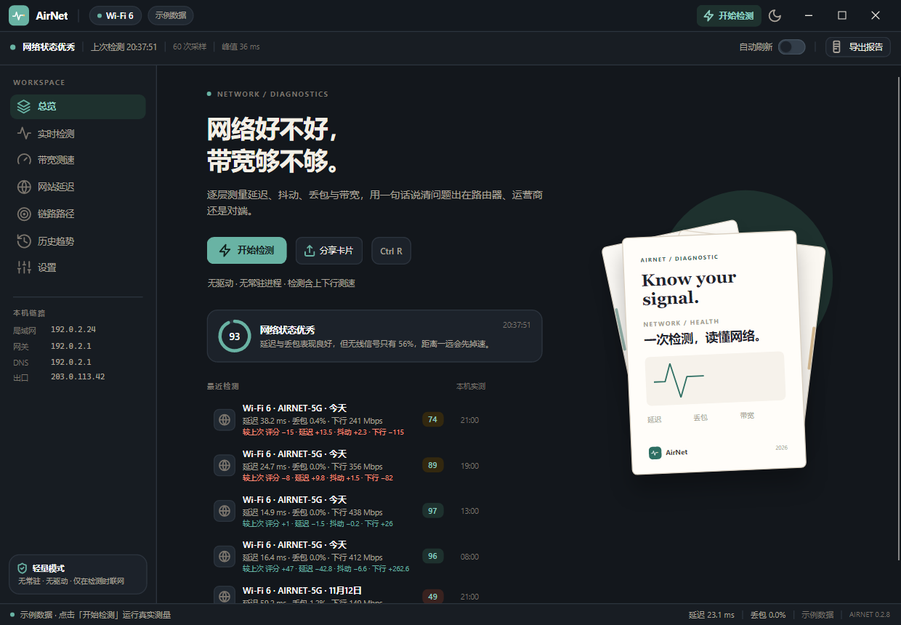
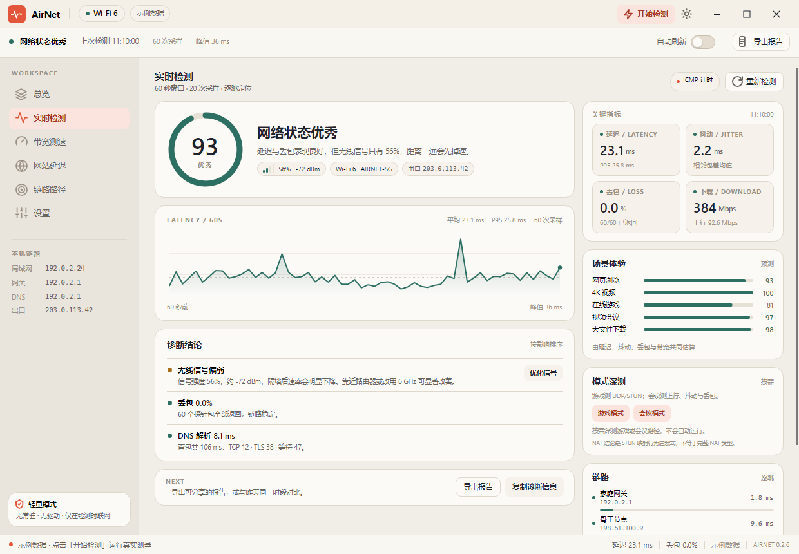
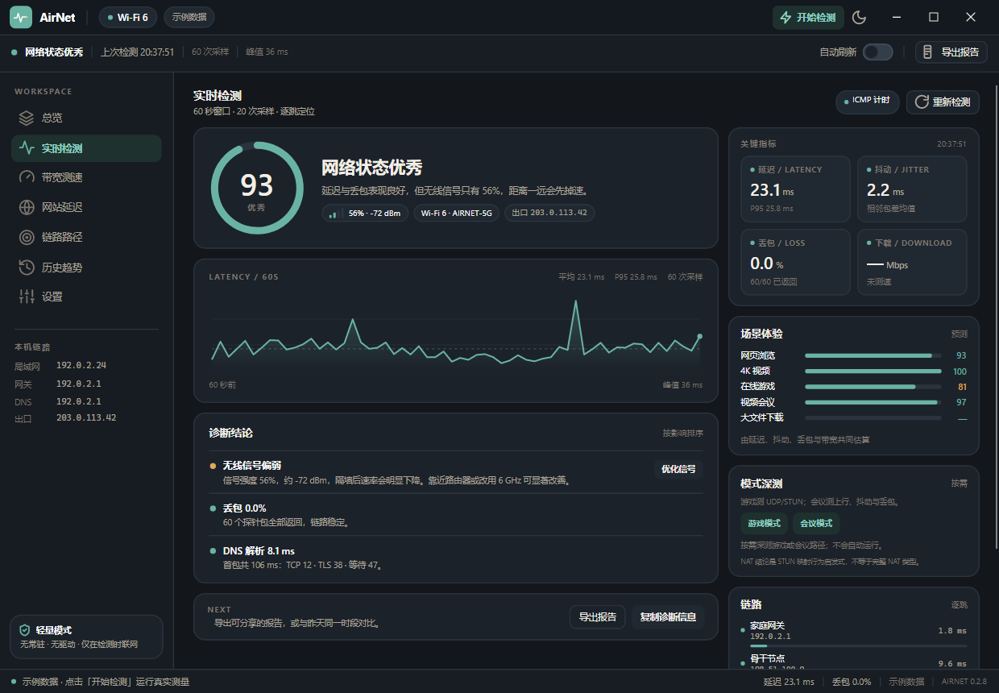
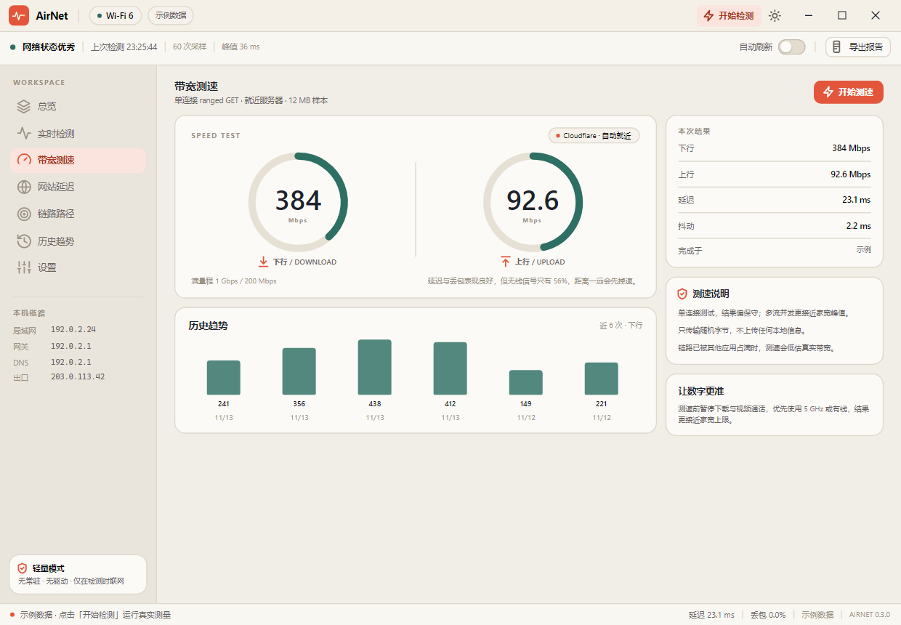
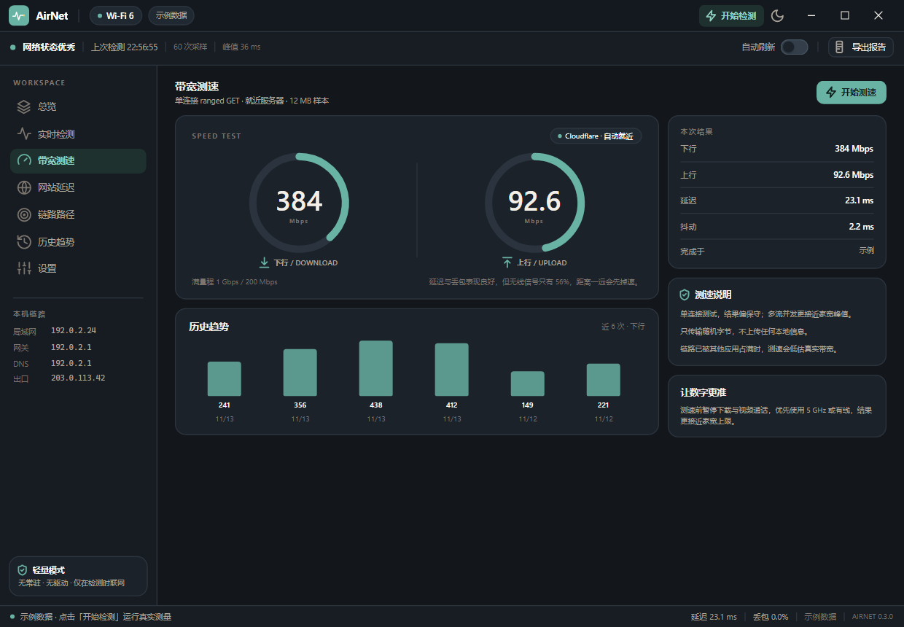

# AirNet 视觉规范 v0.1

> 与 `F:\AirPdf`（AirPDF）同一套"纸张"语言的产品族版本。本文记录**继承了什么、改了什么、为什么**，
> 以及落地到 Avalonia 的 token 与组件清单。所有截图来自本仓库里可运行的原型（`src/AirNet.App`）。

---

## 1. 设计目标

AirNet 的定位是"轻量、快速检测和优化网络"。视觉要服务三个判断，而不是装饰：

| 原则 | 视觉落地 |
| --- | --- |
| **一眼可读**：3 秒内知道网络好不好 | 首页一句结论 + 一个健康分环；仪表盘首屏只有 6 张卡片 |
| **轻**：像一个随手打开的工具，不像安全软件 | 暖白纸感底、细描边、无渐变无光效、无常驻图标；单窗口、无向导 |
| **可信**：每个数字都能解释 | 数字 + 单位 + 口径（P95、采样数、满量程）；结论后面永远跟证据和建议 |

## 2. 与 AirPDF 的继承与差异

**继承**（保持产品族一致性）：

- 暖白"纸张"色板：`#F1EEE7` 底、`#FBFAF7` 卡面、`#DED7CB` 描边；
- 字号阶梯与字重：h1 34 / h2 21 / h3 15 / eyebrow 10 / caption 11.5；
- 圆角体系：卡片 14、控件 8–10、胶囊 999；
- 布局骨架：44px 品牌条 + 46px 工具条 + 侧栏 + 内容 + 30px 状态条；
- 手绘线条图标（Lucide 24×24，1.8 描边）、衬线体标题插画、"纸叠"构图；
- 主题：浅色 / 深色 / 跟随系统三态，同一套 token key。

**改变**（让 AirNet 自己成立）：

| 维度 | AirPDF | AirNet | 理由 |
| --- | --- | --- | --- |
| 主色 | 陶土 `#E3563B` | **青 `#2E6F63`** | 网络健康用"平静"的青绿；陶土降级为**告警色**，链路变差时才出现，成为两兄弟产品的暗号 |
| 语义色 | 无（只有强调/危险） | good / warn / bad 三档 | 网络诊断必须有三档状态，且要与主色同族 |
| 第二色 | 青 `#2E6F63`（次） | 陶土 `#E3563B`（仅告警） | 角色互换，色板仍是同一组 |
| 主体 | 单文档阅读画布 | 仪表盘卡片网格 + 侧栏导航 | 工具类产品需要固定四页，阅读器是文档驱动 |
| 数字声音 | 无 | 专用数值字号/字距，等宽用于地址与端口 | 测量值需要"仪表感" |
| 主题默认 | 跟随系统 | 跟随系统（原型默认浅色便于评审） | — |

> 结论：**同一张纸，换了一支笔。** 用户如果同时装了 AirPDF，会认出是同一家做的；但 AirNet 的青绿 + 三档状态一眼就能区分用途。

## 3. 色板（Token）

### 3.1 基础层

| Token | Light | Dark | 用途 |
| --- | --- | --- | --- |
| `AppBackgroundBrush` | `#F1EEE7` | `#13171C` | 应用底 |
| `TitleBarBackgroundBrush` | `#F4F0E8` | `#14191F` | 品牌条 |
| `ToolbarBackgroundBrush` | `#F9F7F2` | `#181D23` | 状态工具条 |
| `SidebarBackgroundBrush` | `#EAE5DC` | `#171C22` | 侧栏 |
| `SurfaceBrush` | `#FBFAF7` | `#1C222A` | 卡片 |
| `SurfaceAltBrush` | `#F6F2EB` | `#202831` | 卡片内嵌块 |
| `SurfaceHoverBrush` | `#EDE7DD` | `#2A333D` | 悬停 |
| `SurfacePressedBrush` | `#E3DCCF` | `#333E4A` | 按下 / 滑轨 |
| `BorderBrush` | `#DED7CB` | `#2C343E` | 1px 描边 |
| `BorderStrongBrush` | `#C7BEB0` | `#43505D` | 强调描边、开关轨 |
| `TextPrimaryBrush` | `#1D232C` | `#F3EFE6` | 主文本 |
| `TextSecondaryBrush` | `#69645C` | `#ABA49A` | 说明文本 |
| `TextTertiaryBrush` | `#9A9286` | `#7B756D` | 辅助/时间戳 |
| `StatusBackgroundBrush` | `#F9F7F2` | `#181D23` | 状态条 |

### 3.2 强调与语义

| Token | Light | Dark | 说明 |
| --- | --- | --- | --- |
| `AccentBrush` | `#2E6F63` | `#69B3A4` | 主色：健康、主操作、图表 |
| `AccentHoverBrush` | `#245A50` | `#86C6B8` | 主按钮悬停 |
| `AccentSoftBrush` | `#E2EFEB` | `#1E312E` | 主色浅底（软按钮、选中态） |
| `AccentTextBrush` | `#1F5A50` | `#8FD0C2` | 主色文字 |
| `AccentOnBrush` | `#FFFFFF` | `#10201C` | **主色底上的文字**（深色主题主色偏亮，必须用深墨） |
| `GoodBrush` | `#2E6F63` | `#69B3A4` | 健康（= 主色） |
| `GoodSoftBrush` | `#E2EFEB` | `#1E312E` | 健康浅底 |
| `WarnBrush` | `#A9701A` | `#E0A85C` | 警告（暖琥珀，仍在纸张色域内） |
| `WarnSoftBrush` | `#F6EAD4` | `#33280F` | 警告浅底 |
| `BadBrush` | `#B23A2B` | `#FF8E79` | 严重（陶土系，与 AirPDF 主色同源） |
| `BadSoftBrush` | `#F8E2DD` | `#39221F` | 严重浅底 |
| `BrandBrush` | `#E3563B` | `#FF6B4E` | 仅插画点缀，不做 UI 语义 |
| `TrackBrush` | `#E7E0D4` | `#2B343E` | 环/条/滑轨 |
| `GridLineBrush` | `#E4DCD0` | `#242C35` | 图表网格 |
| `GuideBrush` | `#B9AE9E` | `#4A5764` | 图表参考线（均值/P95） |
| `ChartFillBrush` | `#42→00 2E6F63` | `#4D→00 69B3A4` | 面积图渐变 |

对比度（浅色）：主文本 12.9:1、次文本 5.6:1、主色白字 5.4:1；深色：主文本 13.8:1、主色深墨字 8.0:1。均达 WCAG AA。

## 4. 字体与字号阶梯

```
AppFontFamily     : Inter, Segoe UI, Microsoft YaHei UI, Noto Sans CJK SC, PingFang SC, sans-serif
DisplayFontFamily : Georgia, Times New Roman, Songti SC, SimSun, serif     ← 仅插画标题
MonoFontFamily    : Cascadia Mono, Consolas, SF Mono, Menlo, monospace     ← IP / 端口 / 时间
```

| 角色 | 字号 / 字重 / 字距 | 用例 |
| --- | --- | --- |
| `.h1` | 34 / SemiBold / -0.8，行高 44 | 首页主张（两行） |
| `.h2` | 21 / SemiBold / -0.2 | 卡片内结论 |
| `.h3` | 15 / SemiBold | 区块标题 |
| `.eyebrow` | 10 / Bold / +1.3 / 全大写 | 栏目元信息（NAVIGATE、LATENCY / 60S） |
| `.caption` | 11.5 / Regular | 说明、副标题 |
| `.micro` | 10.5 / Regular / 三级色 | 时间戳、口径注释 |
| `.value` | 23 / SemiBold / -0.7 | 指标值 |
| `.valueBig` | 38 / SemiBold / -1.6 | 测速大数字 |
| `.unit` | 10.5 / SemiBold / 二级色 | 单位（ms、Mbps、%） |
| `.mono` | 11 / Regular 等宽 | IP、DNS、耗时 |

**硬规则：中文不小于 10px。** 8–9px 的中文在 1× 渲染下笔画会糊成一团（原型第一版踩过，`延迟/丢包/抖动` 全部不可读），因此中文最低 10，只有拉丁字母与数字允许 8–9.5。

## 5. 间距、圆角、描边、阴影

- 间距基数 **2 的倍数**；卡片内边距 16–22；卡片间距 12（列表内 8–10）。
- 圆角：卡片 14、内嵌块 10、按钮 8–10、胶囊 999、开关 11。
- 描边统一 **1px** `BorderBrush`；**不用重阴影做层级**，只用 1px 线与底色差。
- 阴影只在两处：① 首页"纸叠"插画（`0 14/22/50` 三级）；② 浮层（`0 12 30 #1A000000`）。
- 分割线：1px `BorderBrush`，高度 14（行内）/ 1px 通栏（块间）。

## 6. 布局骨架

```
┌────────────────────────────────────────────── 44 品牌条：Logo+字标 │ 链路胶囊 │ 示例数据 │ 开始检测 │ 主题 │ 窗口按钮
├────────────────────────────────────────────── 46 状态条：结论 │ 上次检测 │ 采样数 │ 峰值 ………… 自动刷新开关 │ 导出报告
├──────────┬───────────────────────────────────
│ 216 侧栏 │ 内容区（各页自管，最大宽 1000–1160）
│ WORKSPACE│
│  总览    │
│  实时检测│
│  带宽测速│
│  设置    │
│ 本机链路 │
│ 轻量模式 │
├──────────┴───────────────────────────────────
└────────────────────────────────────────────── 30 状态条：运行状态 │ 延迟 │ 丢包 │ 采集时间 │ 版本
```

内容区最大宽 1160，窗口最小 1040×700；页面内容在视口内居中，避免大屏拉散。

## 7. 组件

| 组件 | 类名 / 控件 | 规格 |
| --- | --- | --- |
| 主按钮 | `Button.primary` | 高 34–40、圆角 10、主色底 + `AccentOnBrush` 字 |
| 软按钮 | `Button.soft` | 主色浅底 + 主色字，用于"开始检测"这类次级主操作 |
| 描边按钮 | `Button.ghost` | 卡面色 + 1px 描边 |
| 图标按钮 | `Button.icon` / `.small` | 34 / 28 方，圆角 8 |
| 胶囊 | `Button.chip` / `Border.pill` | 高 28–26，圆角 999，1px 描边 |
| 迷你动作 | `Button.mini` | 高 24，`SurfaceAlt` 底，用于诊断建议的"优化 DNS" |
| 侧栏项 | `Button.nav` + `.active` | 高 34，选中为主色浅底 + 左图标转主色 |
| 卡片 | `Border.card` | 卡面色 + 1px 描边 + 圆角 14 |
| 内嵌块 | `Border.tile` | `SurfaceAlt` + 描边 + 圆角 10 |
| 分段控件 | `Button.seg` + `.active` | 高 30，选中白底 + 描边 + 微阴影 |
| 开关 | `ToggleButton.switch` | 38×21，选中主色，白钮 15 |
| 状态点 | `Ellipse.sevDot` / `.tileDot` | 5–7px，good/warn/bad/info 四态 |
| 窗口按钮 | `Button.windowControl` | 46×32，关闭键悬停 `#C42B1C` |

## 8. 图表

四个自绘控件（无第三方图表库，全部 `Avalonia.Control` + `DrawingContext`）：

| 控件 | 参数 | 用法 | 规范 |
| --- | --- | --- | --- |
| `ScoreRing` | `Value/Maximum/Thickness/StartAngle(-90)/SweepAngle(360)/TrackBrush/ProgressBrush` | 健康分、上下行测速 | **360° 圆环**，缺口在 12 点方向；轨道平头（圆头会在接近满值处留下一颗"孤点"），进度圆头 2px 收边 |
| `Sparkline` | `Series/Stroke/Fill/GridLines/GuideValue/ShowEndDot` | 延迟时间线、卡片缩略 | 面积用 `ChartFillBrush`；均值参考线 1px 虚线 `3,4`；末点 3.2px 圆点；自适应 min/max 并留 12% 余量 |
| `MeterBar` | `Value(0-1)/TrackBrush/FillBrush` | 场景分数、逐跳耗时 | 高 3–5，圆角半高，短值时保证最小可见宽度 |
| `SignalBars` | `Percent/FillBrush/EmptyBrush` | 无线信号 | 4 根 3px 柱（4/7/10/13 高），按 25% 阶梯点亮 |

**首包分解条**（M1 新增，位于"链路"卡片底部）：把 DNS / TCP / TLS / 等待首字节四段按耗时占比画成一条
284px 的堆叠条，同一色系四档透明度（1.0 / 0.72 / 0.46 / 0.24）递减，下方图例给出毫秒数，右侧是总首包时间。
用同一主色的透明度阶梯而不是四种颜色，是因为四段是同一条路径上的阶段，不是四类不同的事物。

规则：**图表只用主色 + 参考线灰**；出现告警色时整页最多一处，避免"仪表盘花屏"。

## 9. 首页插画：纸叠

三张"报告纸"叠放，是 AirPDF 首页纸叠的直系变体：

- 底层：空白纸 + 左缘青色索引条（`-12°`）；
- 中层：空白纸 + 右缘琥珀索引条（`7°`）；
- 顶层：**唯一有内容的卡**（`-2.5°`），承载 "AIRNET / DIAGNOSTIC" 小标、衬线标题 `Know your signal.`、健康分环、延迟曲线、三项指标、页脚字标。

规则：**只有最上面一张写内容**。后排纸一旦露出被裁切的文字，会读成渲染错误（第一版就是这样，已改为纯纸 + 索引条）。

## 10. 动效（原型未实现，规范已定）

| 场景 | 时长/曲线 | 说明 |
| --- | --- | --- |
| 页面切换 | 160ms，`EaseOut`，透明度 0→1 + 位移 6px | 不做横向滑动（工具类不应"翻页"） |
| 数字变化 | 420ms，数字滚动（Interpolate） | 健康分、延迟值、测速 |
| 环/条填充 | 600ms，`EaseOutCubic` | 首次进入与数据更新 |
| 时间线 | 每帧追加，300ms 线性 | 实时采样时曲线右移 |
| 按压反馈 | 90ms 背景过渡 | 全站统一 |

## 11. 无障碍

- 中文最小 10px、正文 11.5–14；对比度见 §3.2。
- 所有图标按钮都有 `ToolTip` 与可读名称；窗口按钮可 Tab 到达。
- 三档状态**不只靠颜色**：结论用文字（优秀/良好/一般/较差）+ 点 + 分数，色盲用户仍可判断。
- 主题跟随系统；深色主题主色变亮，主按钮文字自动切深墨（`AccentOnBrush`）。

## 12. 代码位置

```
src/AirNet.App/
  Styles/Colors.axaml      色板 token（Light/Dark 双字典 + 字体 + 圆角）
  Styles/Icons.axaml       37 个图标（Lucide 线性风格）
  Styles/Controls.axaml    字号阶梯、按钮、卡片、开关、状态点、图表默认值
  Controls/ScoreRing.cs    360° 环
  Controls/Sparkline.cs    延迟曲线
  Controls/MeterBar.cs     条
  Controls/SignalBars.cs   信号柱
  Views/ShellView.axaml    骨架：品牌条 / 状态条 / 侧栏 / 状态栏
  Views/OverviewView.axaml 首页 + 纸叠插画
  Views/MonitorView.axaml  仪表盘
  Views/SpeedView.axaml    测速
  Views/SettingsView.axaml 设置
```

## 13. 截图

| 页面 | 浅色 | 深色 |
| --- | --- | --- |
| 总览 |  |  |
| 实时检测 |  |  |
| 带宽测速 |  |  |
| 设置 |  |  |

截图由 `AirNet.exe --export <目录> --scale 1` 生成：程序在屏幕外真实渲染窗口后逐页抓取，与最终运行时像素一致。
